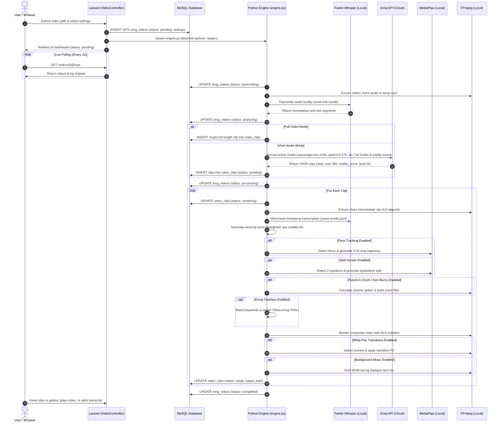

# 🗺️ RoninClips — Master Codebase & Architecture Map (`CODETREE.md`)

> **Source of Truth for Project Architecture, Directory Structure, Subsystem Interactions, and Implementation Details.**  
> *Use this document for rapid navigation, exact file path discovery, and zero-hallucination development.*

---

## 📑 Table of Contents
1. [System Architecture Overview](#-system-architecture-overview)
2. [Complete Annotated File Tree](#-complete-annotated-file-tree)
3. [Component & Subsystem Breakdown](#-component--subsystem-breakdown)
   - [1. Frontend & Dashboard Orchestration (Laravel 12)](#1-frontend--dashboard-orchestration-laravel-12)
   - [2. AI Processing Engine (Python 3.10+)](#2-ai-processing-engine-python-310)
   - [3. Database Layer (MySQL)](#3-database-layer-mysql)
   - [4. Packaging, Scripts & CLI](#4-packaging-scripts--cli)
4. [Data Flow & Processing Lifecycle](#-data-flow--processing-lifecycle)
5. [Processing Settings & Feature Flags](#-processing-settings--feature-flags)
6. [Critical Gotchas & Anti-Hallucination Guidelines](#-critical-gotchas--anti-hallucination-guidelines)

---

## ⚡ System Architecture Overview

RoninClips is a **hybrid local-first AI video clipper and subtitle engine** designed to run 100% offline and free without external cloud fees (leveraging local Faster-Whisper, local MediaPipe face tracking, Groq free-tier LLMs, and local FFmpeg).

```
┌─────────────────────────────────────────────────────────────────────────────┐
│                          USER / BROWSER INTERFACE                           │
│     Web Dashboard (Blade + Vanilla CSS + Lucide Icons + Live Polling)       │
└──────────────────────────────────────┬──────────────────────────────────────┘
                                       │ HTTP POST / GET / AJAX
                                       ▼
┌─────────────────────────────────────────────────────────────────────────────┐
│                      LARAVEL 12 CONTROLLER & ORCHESTRATION                  │
│   • VideoController: store, getLogs, openExplorer, getTranscript, reRender  │
│   • Spawns background Python worker detached from PHP process               │
└──────────────────┬───────────────────────────────────────┬──────────────────┘
                   │ SQL (Read/Write State)                │ Spawns CLI Process
                   ▼                                       ▼
┌──────────────────────────────────────┐  ┌───────────────────────────────────┐
│           MYSQL DATABASE             │  │      PYTHON PROCESSING ENGINE     │
│   • long_videos (Metadata, Settings) │  │  • engine.py (Orchestrator)       │
│   • video_clips (Timestamps, Paths)  │  │  • face_tracker.py (MediaPipe)    │
└──────────────────────────────────────┘  │  • audio_mixer.py (RMS Ducking)   │
                                          │  • effects.py (Punch-In/KenBurns) │
                                          │  • emoji_overlay.py (Pillow/PNG)  │
                                          │  • transitions.py (Whip-Pan)      │
                                          │  • split_screen.py (Podcasts)     │
                                          │  • re_render_clip.py (Editor)     │
                                          └─────────────────┬─────────────────┘
                                                            │ Calls CLI Tools
                                                            ▼
                                          ┌───────────────────────────────────┐
                                          │   FFmpeg / FFprobe / Whisper      │
                                          │  • Faster-Whisper (Int8 STT)      │
                                          │  • Groq API (Viral Hook Detection)│
                                          │  • MediaPipe BlazeFace (Tracking) │
                                          │  • FFmpeg Complex Filters (Render)│
                                          └───────────────────────────────────┘
```

---

## 🌳 Complete Annotated File Tree

```text
roninclips/
├── .editorconfig                          # Editor formatting rules
├── .env                                   # Active environment configuration (DB credentials, GROQ_API_KEY)
├── .env.example                           # Template environment file
├── .gitattributes                         # Git line-ending / attribute settings
├── .gitignore                             # Git ignore rules (vendor, node_modules, temp media)
├── .npmrc                                 # NPM registry configuration
├── artisan                                # Laravel Artisan command-line executable
├── composer.json                          # PHP / Laravel dependencies and metadata
├── composer.lock                          # Locked PHP dependency versions
├── package.json                           # Node.js manifest (scripts, CLI entry point, Tailwind/Vite)
├── package-lock.json                      # Locked Node.js dependency versions
├── phpunit.xml                            # PHPUnit test configuration
├── vite.config.js                         # Vite asset bundler configuration
│
├── 📜 Documentation & Specifications
│   ├── CODETREE.md                        # Master codebase navigation & architecture index (THIS FILE)
│   ├── README.md                          # Project introduction, install guides & features
│   ├── PROJECTCONTEXT.MD                  # Architectural blueprints, original design specs & pro-tips
│   └── DesignInspo.md                     # OpenCode-inspired monospaced TUI design specs & token palette
│
├── 🚀 Launchers & Install Scripts
│   ├── setup.bat                          # Automated Windows installer (checks PHP, Python, FFmpeg, Composer)
│   ├── start.bat                          # One-click Windows launcher (opens browser + runs artisan serve)
│   ├── install.ps1                        # Remote PowerShell one-liner installer
│   └── bin/
│       └── cli.js                         # Node CLI wrapper for `npx roninclips` / global npm executable
│
├── 📁 app/                                # Laravel Application Core (PHP 8.2+)
│   ├── Http/
│   │   └── Controllers/
│   │       ├── Controller.php             # Base abstract controller
│   │       └── VideoController.php        # Core backend controller (ingestion, logs, re-rendering, deletion, file picker)
│   ├── Models/
│   │   ├── LongVideo.php                  # Eloquent Model for `long_videos` table (casts processing_settings)
│   │   ├── VideoClip.php                  # Eloquent Model for `video_clips` table (belongsTo LongVideo)
│   │   └── User.php                       # Default Laravel User authentication model
│   └── Providers/
│       └── AppServiceProvider.php         # Application service container boots & bindings
│
├── 📁 bootstrap/                          # Laravel Bootstrapping
│   ├── app.php                            # App configuration, middleware & exception handlers
│   └── providers.php                      # Registered service providers
│
├── 📁 config/                             # Laravel Configuration Files
│   ├── app.php                            # App name, env, debug, timezone, service providers
│   ├── auth.php                           # User authentication and password reset guards
│   ├── cache.php                          # Cache store adapters (database, redis, file)
│   ├── database.php                       # MySQL / SQLite connection configurations
│   ├── filesystems.php                    # Local & public storage disk definitions
│   ├── logging.php                        # Log channels and error reporting configurations
│   ├── mail.php                           # Email driver and server configurations
│   ├── queue.php                          # Queue driver configuration (database queue)
│   ├── services.php                       # Third-party service credentials
│   └── session.php                        # Session drivers and lifetime settings
│
├── 📁 database/                           # Database Schema & Migrations
│   ├── factories/                         # Model factory definitions for testing
│   ├── migrations/
│   │   ├── 0001_01_01_000000_create_users_table.php
│   │   ├── 0001_01_01_000001_create_cache_table.php
│   │   ├── 0001_01_01_000002_create_jobs_table.php
│   │   ├── 2026_06_29_173953_create_long_videos_table.php     # Creates `long_videos` table
│   │   ├── 2026_06_29_174003_create_video_clips_table.php    # Creates `video_clips` table
│   │   └── 2026_06_30_165400_add_processing_settings_to_long_videos.php # Adds JSON settings column
│   └── seeders/                           # Database seeders
│
├── 📁 processor/                          # Python AI & Media Processing Subsystem
│   ├── requirements.txt                   # Python dependencies (faster-whisper, mediapipe, groq, etc.)
│   ├── db_helper.py                       # Unified Dual-DB connector (transparent SQLite & MySQL support)
│   ├── hw_accel.py                        # Hardware acceleration probe (CUDA Faster-Whisper & NVENC/QSV/AMF)
│   ├── engine.py                          # Master processing orchestrator (Single-pass Whisper + Groq + FFmpeg pipeline)
│   ├── subtitles.py                       # Shared ASS subtitle generator, palette presets & path escaping
│   ├── face_tracker.py                    # MediaPipe face tracking & 9:16 smart cropping generator
│   ├── audio_mixer.py                     # RMS speech detection & dynamic background music ducking
│   ├── effects.py                         # Audio volume spike detection, punch-in zoom & Ken Burns FX
│   ├── emoji_overlay.py                   # Transcript keyword scanner & PIL/FFmpeg animated emoji overlays
│   ├── transitions.py                     # Scene change detector & FFmpeg whip-pan transition generator
│   ├── split_screen.py                    # Two-speaker podcast layout detector & split-screen compositor
│   ├── re_render_clip.py                  # Standalone transcript subtitle & BGM re-render executor
│   └── models/
│       └── blaze_face_short_range.tflite  # MediaPipe BlazeFace short range detection model weights
│
├── 📁 tests/                              # Application Test Suite
│   ├── TestCase.php                       # Base PHPUnit test case
│   ├── Pest.php                           # Pest PHP testing setup
│   ├── Feature/                           # Feature integration tests (Pest suite)
│   │   └── ExampleTest.php                # Dashboard, retry, logs, status, validation & cleanup tests
│   ├── Unit/                              # Unit tests
│   └── python/                            # Python unit test suite
│       └── test_processor.py              # ASS formatting, filters, Groq parsing & timestamps tests
│
├── 📁 public/                             # Public Web Assets & HTTP Entry Point
│   ├── .htaccess                          # Apache URL rewrite configurations
│   ├── index.php                          # HTTP entry point for Laravel
│   ├── robots.txt                         # Web crawler instructions
│   ├── favicon.ico                        # App favicon
│   ├── storage                            # Symlink to storage/app/public for media serving
│   ├── js/
│   │   └── lucide.min.js                  # Bundled Lucide icons for 100% offline air-gapped readiness
│   └── css/
│       └── app.css                        # Complete custom stylesheet (Berkeley Mono / OpenCode dark theme)
│
├── 📁 resources/                          # Frontend Resources
│   ├── css/
│   │   └── app.css                        # Base CSS source
│   ├── js/
│   │   └── app.js                         # JavaScript entry
│   └── views/
│       ├── dashboard.blade.php            # Primary monolithic dashboard view (Form, Terminal, Editor, Gallery)
│       └── welcome.blade.php              # Legacy welcome view
│
├── 📁 routes/                             # Application Routing
│   ├── web.php                            # Web routes (Dashboard, Video store, Logs polling, Re-render)
│   └── console.php                        # Artisan console command routes
│
├── 📁 storage/                            # Generated Media, Logs & Temporary Files
│   ├── app/                               # Working files (intermediate clips, audio WAVs, ASS subtitles)
│   │   └── public/                        # Rendered MP4 clips served to frontend (symlinked)
│   ├── framework/                         # Laravel view caches, sessions, and compile cache
│   └── logs/                              # Engine execution logs (engine_{video_id}.log)
│
```

---

## 🔍 Component & Subsystem Breakdown

### 1. Frontend & Dashboard Orchestration (Laravel 12/13)

| File | Type | Primary Role & Description |
| :--- | :--- | :--- |
| [`routes/web.php`](routes/web.php) | Route Config | Declares web endpoints: `GET /` (Dashboard), `POST /videos` (Process video), `POST /videos/{video}/retry` (1-click job retry), `GET /videos/{id}/logs` (Live log polling), `DELETE /videos/{video}` (Delete video & clips), `DELETE /clips/{clip}` (Delete single clip), `POST /clips/{clip}/explorer` (Reveal file in Windows Explorer), `GET /clips/{clip}/transcript` (Get word JSON), `GET /clips/{clip}/status` (Status polling), `POST /clips/{clip}/re-render` (Re-render clip with edited words). |
| [`app/Http/Controllers/VideoController.php`](app/Http/Controllers/VideoController.php) | PHP Controller | Handles video path validation, parsing of 16 strategy settings, database record creation, and detached background process execution (`pclose(popen('start /B cmd /c ...'))` on Windows). Streams engine logs, manages artifact cleanup (`cleanupClipFiles`), and orchestrates transcript re-rendering. |
| [`app/Models/LongVideo.php`](app/Models/LongVideo.php) | Eloquent Model | Represents uploaded source videos in `long_videos` table. Automatically casts `processing_settings` to array and defines `clips()` 1:N relationship. |
| [`resources/views/dashboard.blade.php`](resources/views/dashboard.blade.php) | Blade Template | Studio-grade Two-Column Creator Workspace featuring: (1) Top System HUD with live GPU CUDA/CPU badge, Groq LLM model, database driver, and active job indicators, (2) Sticky Left Sidebar with Ingestion dropzone, Native Windows File Picker, Strategy Presets, and Collapsible Settings with live Subtitle Preview Simulator, (3) Right Main Canvas with multi-step live progress tracking, console logs, and Master Clip Gallery, (4) Hover-to-Play Video Scrubbing with 1-click Download & Copy Post actions, (5) Cinema Lightbox Modal with Safe-Zone overlays (TikTok, Reels, Shorts) and Social Media Posting Kit. |
| [`public/css/app.css`](public/css/app.css) | Vanilla CSS | Studio Glassmorphic Dark theme design system (Berkeley Mono / OpenCode dark palette) with zero-latency local offline font fallbacks (`JetBrains Mono`, `Cascadia Code`, `Fira Code`, `Consolas`). Features low-glare obsidian glass cards, responsive two-column grid (`.studio-workspace`), custom animated metric bars, safe-zone bounding boxes, and toast notifications. |

---

### 2. AI Processing Engine (Python 3.10+)

| File | Module | Key Functions & Logic |
| :--- | :--- | :--- |
| [`processor/engine.py`](processor/engine.py) | **Pipeline Orchestrator** | Coordinates the entire clipping lifecycle: <br>• Ingests `VIDEO_ID` and settings via `db_helper.py`.<br>• Extracts audio with FFmpeg.<br>• Runs single-pass local Speech-to-Text via `faster-whisper` (`WhisperModel`, `word_timestamps=True`) and slices word timings per clip.<br>• Prompts Groq LLMs (`openai/gpt-oss-120b`, `llama-3.3-70b-versatile`) across multi-chunk 28k-char windows to detect 30–60s viral hooks.<br>• Extracts **frame-accurate intermediate clips** (`-ss after -i`, `-avoid_negative_ts make_zero`, `-async 1`) to eliminate audio/subtitle desync.<br>• Integrates smart crop, zoom FX, emojis, transitions, BGM auto-ducking, and generates word-by-word highlighted ASS subtitles. |
| [`processor/subtitles.py`](processor/subtitles.py) | **ASS Subtitle Generator** | Shared module defining 8 high-contrast color palettes, millisecond time formatting (`format_ass_time`), FFmpeg path escaping (`ffmpeg_escape_path`), and ASS tag/comma sanitization. Consumed by both `engine.py` and `re_render_clip.py`. |
| [`processor/face_tracker.py`](processor/face_tracker.py) | **Smart Crop & Tracking** | Uses MediaPipe Tasks API (BlazeFace Short Range `.tflite`) to detect faces across sampled frames on intermediate clips. Calculates bounding box centers, applies exponential smoothing (`alpha=0.08`), clamps to video bounds, and generates dynamic or simple 9:16 FFmpeg `crop=w:h:x:y` filters. |
| [`processor/split_screen.py`](processor/split_screen.py) | **Podcast Split-Screen** | Analyzes face positions across video frames to identify two primary speakers (Left Zone and Right Zone). Generates dual-crop FFmpeg filter complex that stacks the two speakers into a vertical 9:16 top/bottom composition. |
| [`processor/audio_mixer.py`](processor/audio_mixer.py) | **BGM & Auto-Ducking** | Analyzes speech regions via audio RMS energy calculation using concurrency-safe UUID temp files. Generates dynamic volume envelopes (`volume='if(between(t,...), 0.12, 0.40)':eval=frame`) to duck background music during dialogue and boost music during pauses. |
| [`processor/effects.py`](processor/effects.py) | **Motion FX & Punch-In** | Detects audio volume spikes (moments of vocal excitement/climax) using sliding RMS energy windows. Generates scale-and-crop zoom filters (1.15x punch-in) or Ken Burns slow zoom (1.0x to 1.05x). Avoids buggy `zoompan` filter to preserve full framerate. |
| [`processor/emoji_overlay.py`](processor/emoji_overlay.py) | **Animated Emojis** | Scans transcript words against an extensive keyword dictionary (e.g. fire, money, shock, brain, danger). Renders high-res emoji PNGs via Pillow and creates timed FFmpeg overlay filter complex commands with subtle scale/pop animations. |
| [`processor/transitions.py`](processor/transitions.py) | **Whip-Pan Transitions** | Detects scene changes using FFmpeg scene score filter (`select='gt(scene,0.3)'`). Splits clips into segments and applies multi-directional directional blur / whip-pan transition effects at cut points. |
| [`processor/re_render_clip.py`](processor/re_render_clip.py) | **Transcript Editor Re-renderer** | Invoked when a user edits words or timestamps in the dashboard transcript editor. Reads updated `clip_{id}_words.json`, generates fresh `.ass` subtitles, burns them onto the intermediate clip, and re-mixes BGM in seconds without re-running transcription or AI analysis. |
| [`processor/requirements.txt`](processor/requirements.txt) | Dependencies | Core Python dependencies: `faster-whisper`, `groq`, `mediapipe`, `opencv-python`, `Pillow`, `numpy`, `python-dotenv`, `mysql-connector-python`. |

---

### 3. Database Layer (SQLite / MySQL)

#### Table: `long_videos`
Tracks uploaded source videos and overarching pipeline status.

| Column | Type | Description |
| :--- | :--- | :--- |
| `id` | `INT / INTEGER (Auto Increment, PK)` | Unique identifier for the source video. |
| `filename` | `VARCHAR(255)` | Base filename of the video (e.g., `podcast_01.mp4`). |
| `storage_path` | `VARCHAR(255)` | Absolute filesystem path on host machine. |
| `status` | `VARCHAR / ENUM` | Current state: `'pending'`, `'transcribing'`, `'analyzing'`, `'processing'`, `'completed'`, `'failed'`. |
| `transcript` | `TEXT / LONGTEXT (Nullable)` | Complete text transcript extracted by Faster-Whisper. |
| `processing_settings` | `JSON / TEXT (Nullable)` | Serialized JSON dictionary of user settings used for rendering. |
| `created_at` / `updated_at` | `TIMESTAMP` | Laravel model timestamps. |

#### Table: `video_clips`
Tracks individual clips extracted or generated from a `long_video`.

| Column | Type | Description |
| :--- | :--- | :--- |
| `id` | `INT / INTEGER (Auto Increment, PK)` | Unique identifier for the clip. |
| `long_video_id` | `BIGINT UNSIGNED (FK)` | Foreign key referencing `long_videos.id` (`ON DELETE CASCADE`). |
| `start_time` | `VARCHAR(255)` / `TIME` | Timestamp marking start of clip (e.g. `00:01:15`). |
| `hook_explanation` | `TEXT` / `JSON` | Groq AI generated rich metadata JSON (`title`, `virality_score`, `hook_strength`, `pacing_energy`, `shareability`, `reason`, `social_caption`, `hashtags`, `shorts_description`). |
| `crop_coordinates_json` | `JSON / TEXT (Nullable)` | Face tracking, zoom filter, and split-screen filter cache. |
| `output_path` | `VARCHAR(255) (Nullable)`| Relative path to final MP4 (`storage/app/public/clip_{id}.mp4`). |
| `status` | `VARCHAR / ENUM` | Clip status: `'pending'`, `'rendering'`, `'ready'`. |
| `created_at` / `updated_at` | `TIMESTAMP` | Laravel model timestamps. |

---

### 4. Packaging, Scripts & CLI

| File | Type | Purpose |
| :--- | :--- | :--- |
| [`setup.bat`](setup.bat) | Batch Script | Automatic Windows dependency check (PHP, Composer, Python, FFmpeg), `.env` copy, key generation, composer install, `storage:link`, pip requirements install, and migration execution. |
| [`start.bat`](start.bat) | Batch Script | Launches local Laravel server (`php artisan serve --port=8000`) and automatically opens the user's default browser. |
| [`install.ps1`](install.ps1) | PowerShell | One-liner installation script for remote bootstrapping via GitHub. |
| [`bin/cli.js`](bin/cli.js) | Node.js Executable | NPX entry point enabling `npx roninclips` or global CLI execution. |
| [`check_status.py`](check_status.py) | Python Utility | Reads database directly and prints latest videos and clips with status. |

---

## 🔄 Data Flow & Processing Lifecycle



---

## ⚙️ Processing Settings & Feature Flags

All pipeline settings are configurable from the dashboard and saved as a JSON object in `long_videos.processing_settings`:

| Setting Key | Type | Default | Options / Values | Description |
| :--- | :--- | :--- | :--- | :--- |
| `output_format` | `string` | `'9:16'` | `'9:16'`, `'original'` | Aspect ratio for output video (vertical or raw aspect ratio). |
| `caption_style` | `string` | `'yellow_pop'` | `'yellow_pop'`, `'neon_cyan'`, `'bold_white'`, `'hormozi_box'`, `'karaoke_green'`, `'cyber_pink'` | Word-by-word subtitle color palette and highlighting theme. |
| `caption_font` | `string` | `'Arial Black'` | `'Arial Black'`, `'Impact'`, `'Trebuchet MS'`, `'Verdana'`, `'Montserrat'` | Font family embedded in the generated ASS subtitle script. |
| `caption_position`| `string` | `'bottom'` | `'bottom'`, `'center'`, `'top'` | Vertical alignment of subtitles on screen. |
| `caption_layout` | `string` | `'two_line'` | `'two_line'`, `'single_word'`, `'full_line'` | Word grouping chunk size for caption rendering. |
| `whisper_model` | `string` | `'small'` | `'tiny'`, `'base'`, `'small'`, `'medium'` | Faster-Whisper neural network tier for transcription. |
| `language_mode` | `string` | `'auto'` | `'auto'`, `'translate_en'` | Spoken language mode (`auto` detects, `translate_en` translates to English). |
| `hardware_accel`| `string` | `'auto'` | `'auto'`, `'cpu'` | Hardware acceleration mode (CUDA & GPU encoders vs CPU-only). |
| `transition_speed`| `float` | `0.25` | `0.1` to `1.0` | Duration (in seconds) of whip-pan transition animations. |
| `target_clip_count`| `int` | `5` | `1` to `10` | Number of viral hook candidates Groq should identify. |
| `full_video_mode` | `boolean`| `false` | `true`, `false` | Skips AI hook trimming and processes the entire video end-to-end. |
| `smart_crop` | `boolean`| `true` | `true`, `false` | Uses MediaPipe face detection to center speakers in 9:16 crop. |
| `auto_captions` | `boolean`| `true` | `true`, `false` | Transcribes word-level timestamps and burns ASS animated subtitles. |
| `punch_in_zoom` | `boolean`| `false` | `true`, `false` | Zooms in (1.15x) during moments of elevated voice energy. |
| `ken_burns` | `boolean`| `false` | `true`, `false` | Applies a smooth slow zoom from 1.0x to 1.05x across the clip. |
| `emoji_overlays` | `boolean`| `false` | `true`, `false` | Detects spoken keywords and renders pop-in animated emojis. |
| `whip_pan_transitions`| `boolean`| `false`| `true`, `false` | Applies dynamic whip-pan motion blur at scene changes. |
| `background_music`| `boolean`| `false` | `true`, `false` | Enables background music overlay with automatic speech ducking. |
| `bgm_path` | `string` | `''` | Absolute path | File path to MP3 background audio track. |
| `split_screen` | `boolean`| `false` | `true`, `false` | Formats two-speaker videos into stacked top/bottom split screen. |

---

## ⚠️ Critical Gotchas & Anti-Hallucination Guidelines

When working on or debugging this codebase, adhere strictly to these architectural invariants:

1. **Windows Process Detachment**:
   - On Windows, PHP kills background processes when the web request terminates unless detached properly.
   - Always spawn the Python engine with: `pclose(popen('start /B cmd /c "python ... > log 2>&1"', 'r'))`.
2. **Intermediate Clip Extraction (A/V Sync Fix)**:
   - **Never** render filters, captions, or effects directly against the raw long video with `-ss` in the final render pass.
   - Always extract a self-contained intermediate clip first using output seeking:  
     `ffmpeg -i "input.mp4" -ss START -t DURATION -c:v libx264 -avoid_negative_ts make_zero -async 1 intermediate.mp4`.
   - This ensures video `t=0`, audio `t=0`, and ASS subtitles `t=0` are strictly synchronized.
3. **Windows Path Escaping in FFmpeg Filter Strings**:
   - The FFmpeg filter parser uses `:` as a parameter delimiter. Drive letters (e.g. `C:\`) will crash FFmpeg filter chains unless escaped as `C\:/...` or `C\\:/...`.
   - Use the [`ffmpeg_escape_path()`](processor/subtitles.py) helper to sanitize paths before passing to `ass='...'` or `subtitles='...'`.
4. **Windows UTF-8 Encoding**:
   - Windows defaults to `cp1252` encoding in Python subprocesses and stdout, which crashes when printing Unicode emojis or handling non-ASCII paths.
   - Both `engine.py` and `re_render_clip.py` configure `sys.stdout.reconfigure(encoding='utf-8')` and force UTF-8 in all subprocess executions via custom `run_ffmpeg()`.
5. **MediaPipe Tasks API vs Legacy Solutions**:
   - MediaPipe version `0.10.x+` uses the new Tasks API (`mediapipe.tasks.python.vision.FaceDetector`) and requires `blaze_face_short_range.tflite` model weights located in `processor/models/`. Do not revert to deprecated `mp.solutions.face_detection`.
6. **Zoom Filters vs zoompan**:
   - The FFmpeg `zoompan` filter forces framerate resampling and often causes dropped frames and audio stutter.
   - This engine uses mathematical `scale` + `crop` expressions for punch-in and Ken Burns to preserve native framerate.
7. **Groq Model Fallback Chain**:
   - If a specific Groq model hits rate limits or project restrictions, `engine.py` cycles through a defined fallback array: `["llama-3.3-70b-versatile", "llama-3.1-8b-instant", "llama3-8b-8192", "llama3-70b-8192", "gemma2-9b-it", "mixtral-8x7b-32768"]`.
8. **In-Browser Transcript Editing**:
   - Word timings are preserved in `storage/app/clip_{clip_id}_words.json`.
   - Re-rendering via [`re_render_clip.py`](processor/re_render_clip.py) takes less than 2 seconds because it burns the new ASS subtitle file and re-mixes BGM onto the pre-existing intermediate clip without re-running Whisper or Groq.

---
*Created for RoninClips Codebase Navigation.*
